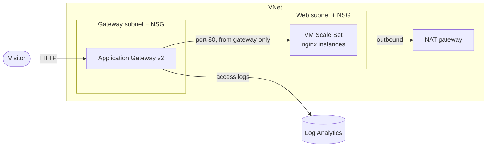

# Azure Web App on VMs

An nginx web app on a VM Scale Set behind an Application Gateway.

OpenTofu demo template. Standalone, no dependency on other repos. Compatible with Terraform.

## Architecture



- Resource group
- VNet with a subnet for Application Gateway and a subnet for the scale set, each with an NSG
- NAT gateway for outbound traffic of the instances (package installs)
- Application Gateway v2 (Standard_v2) with a public IP and DNS label, health probe on `/`
- Linux VM Scale Set (Ubuntu 24.04 LTS, Trusted Launch, nginx via `cloud-init.yaml`), 2 instances
- Log Analytics workspace with Application Gateway access logs

## Security

- Instances without public IPs, no default outbound access (only through the NAT gateway)
- No SSH or RDP from the internet. SSH key only, password login disabled
- Trusted Launch (Secure Boot and vTPM), VM extensions disabled, system-assigned managed identity. Managed disks encrypted at rest with platform-managed keys, encryption at host optional
- Web subnet NSG: HTTP only from the Application Gateway subnet, all other inbound traffic denied
- Application Gateway NSG: port 80 only from `allowed_http_cidrs` (public by default) plus the ports Azure needs to manage the gateway
- Application Gateway access logs to Log Analytics
- HTTP only. HTTPS needs a certificate in Key Vault and is not part of this demo

Accepted checkov findings (documented inline in the code):

| Check | Reason |
|---|---|
| CKV_AZURE_120 | WAF_v2 is out of scope for the demo (cost) |
| CKV_AZURE_217, CKV_AZURE_218 | HTTPS needs a certificate in Key Vault, out of scope for the demo |
| CKV_AZURE_97 | Encryption at host needs a subscription feature, configurable via `encryption_at_host_enabled` |

## Usage

Sign in with `az login` and set `ARM_SUBSCRIPTION_ID` to the target subscription.

```bash
cp terraform.tfvars.example terraform.tfvars
tofu init
tofu plan
tofu apply
```

## Access

Open the `url` output in a browser. Each instance shows its host name, so reloading shows the load balancing. The first response can take a few minutes while cloud-init installs nginx.

There is no SSH access from the internet. For shell access, add Azure Bastion (not part of this template).


## Inputs

| Name | Description | Default |
|---|---|---|
| `name_prefix` | Prefix for all resource names | `"demo"` |
| `location` | Azure location | `"germanywestcentral"` |
| `tags` | Additional tags for all resources | `{}` |
| `ssh_public_key` | SSH public key for the admin user (required) | none |
| `vnet_cidr` | Address space of the VNet | `"10.0.0.0/16"` |
| `vm_size` | VM size, must support Trusted Launch | `"Standard_B2s_v2"` |
| `instance_count` | Number of instances | `2` |
| `admin_username` | Admin user | `"azureuser"` |
| `allowed_http_cidrs` | CIDRs allowed to reach the Application Gateway | `["0.0.0.0/0"]` |
| `encryption_at_host_enabled` | Encryption at host (needs the subscription feature) | `false` |
| `log_retention_days` | Log retention in Log Analytics | `90` |

## Outputs

| Name | Description |
|---|---|
| `url` | URL of the web app |
| `public_ip` | Public IP of the Application Gateway |
| `scale_set_name` | Name of the VM Scale Set |
| `application_gateway_name` | Name of the Application Gateway |
| `resource_group_name` | Name of the resource group |

## Cost

Application Gateway v2, the NAT gateway and the instances are billed hourly, also when idle. Creating the Application Gateway takes about 5 to 10 minutes.

**Destroy after the demo:**

```bash
tofu destroy
```

## Tests

The GitLab pipeline (`.gitlab-ci.yml`) lints every push. Merge requests into `development` or `main` also run
validation, the checkov scan and the unit tests. A tag runs all of these plus the integration tests, which deploy
real resources and destroy them again, and then creates a release. Integration tests run only when the CI/CD variables `AZURE_CLIENT_ID`, `AZURE_TENANT_ID` and `AZURE_SUBSCRIPTION_ID` are set: an app registration with a federated credential for GitLab OIDC and the audience `api://AzureADTokenExchange`.

```bash
tofu test -test-directory=tests/unit
```

Test cases: [tests/README.md](tests/README.md)

## Development

```bash
pre-commit install
pre-commit run --all-files
```
